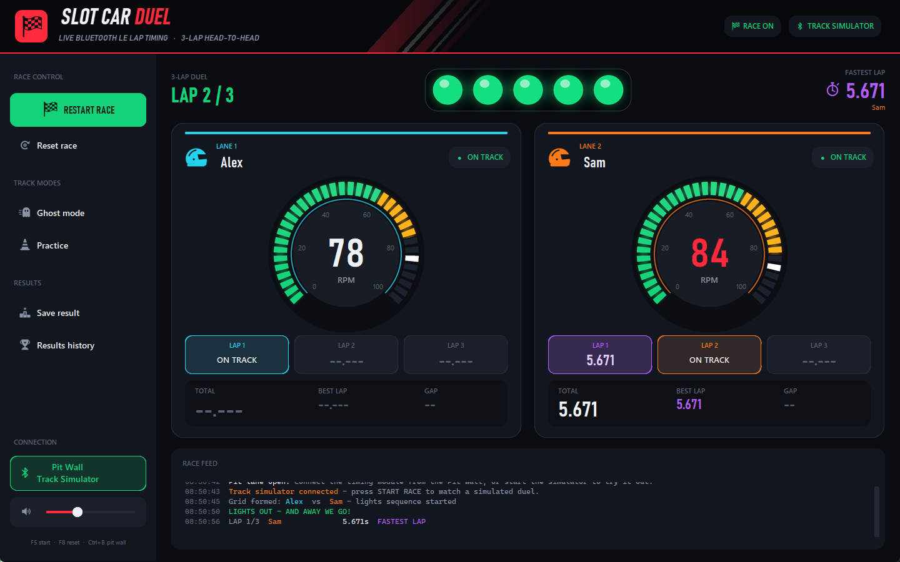

# Slot Car Duel v4

Live Bluetooth LE lap timing for a two-lane slot car track: a 3-lap head-to-head with F1-style start lights, LED tachometers, and a fireworks finish.



This is a ground-up rebuild of `ATESlotCarDemoPython`. It keeps the same hardware protocol and CSV format, with a new modular codebase and a new look.

## Quick start

```powershell
# one-time: create .venv and install everything into it
powershell -ExecutionPolicy Bypass -File .\setup_venv.ps1 -Dev

# run against the real timing hardware
.\run.ps1

# ...or try it with no hardware, using the built-in track simulator
.\run.ps1 -Simulate
```

Everything installs into the project-local **`.venv`**; nothing goes into the system Python. VS Code picks up the venv automatically (`.vscode/settings.json`) and has launch configs for both modes.

| Task | Command |
|---|---|
| Run tests | `.venv\Scripts\python -m pytest` |
| Regenerate icons / `app.ico` | `.venv\Scripts\python tools\generate_assets.py` |
| Build single-file EXE | `.\build_exe.ps1` → `dist\SlotCarDuel.exe` |

## Using it

1. Open the **Pit Wall** (sidebar or `Ctrl+B`), press **Scan**, and double-click the timing module. By default only devices whose name starts with **`Slot`** are listed; turn off **Slot\* devices only** to see every named device.
2. Type driver names on the two lane cards.
3. Press **START RACE** (`F5`). Five red lights come on, then go out. At lights-out the app sends `START_RACE` to the hardware.
4. Laps appear live:
   - **purple** = fastest lap overall
   - **green** = personal best
   - **GAP** shows the time difference between lanes after the same number of laps
5. When both lanes finish 3 laps, the winner is announced with fireworks, crowd audio and speech.
6. **Save result** writes the race summary to `results/raceresults_<timestamp>.csv`. Individual laps are logged as they happen. **Results history** browses all saved sessions.

Shortcuts: `F5` start · `F8` reset · `Ctrl+B` Pit Wall · `Ctrl+R` results · `Esc` dismiss the winner screen.

## Protocol

See **[protocol.md](protocol.md)** for the full BLE specification: GATT UUIDs, framing, every command and message with hex dumps, race semantics, and a firmware checklist.

## Project layout

```
assets/            audio, icons, app.ico
src/slotcar/
  protocol.py      wire protocol: parser, frame assembler, command builders (pure, tested)
  race.py          race model: laps, phases, PB / fastest lap, gap, winner (pure, tested)
  ble.py           bleak transport on a background asyncio loop -> thread-safe event queue
  simulator.py     software timing device speaking the same protocol
  audio.py         music / cheering (pygame-ce) and Windows text-to-speech
  results.py       CSV logging (same columns as v3)
  icons.py         procedural racing icon set, drawn with Pillow
  theme.py         colour + typography tokens
  ui/              CustomTkinter windows and widgets (fireworks.py = procedural fireworks)
tests/             pytest suite for the protocol and the race logic
tools/             asset generator
```

## What changed from v3

- **Look:** dark motorsport theme with a lane colour per driver, a livery-stripe header, racing icons on every button (checkered flag, helmet, ghost, cone, podium, trophy…), LED tachometers with peak hold, F1 start lights, lap tiles with PB/fastest highlighting, toast notifications instead of modal pop-ups, and a winner card over a procedural fireworks show.
- **Structure:** the 1,900-line single file is split into tested modules. BLE threads no longer touch Tk directly; everything flows through one event queue.
- **BLE:** live scan list with RSSI and UART detection; connects can be cancelled; link loss is detected and reported; raw RX/TX hex log with a filter.
- **Robustness:**
  - accepts `\r\n`, `\n\r`, `\n` or `\r` terminators
  - driver names can't break the TTS command
  - the 58 MB fireworks video is replaced by a procedural fireworks show (rockets, sphere / ring / willow / crackle bursts in the winner's lane colour over a floodlit grandstand skyline), so there's no video file and no ffmpeg dependency
- **Behaviour:** `START_RACE` is sent at lights-out rather than on click (see protocol.md §8). Results go to a `results/` folder.
