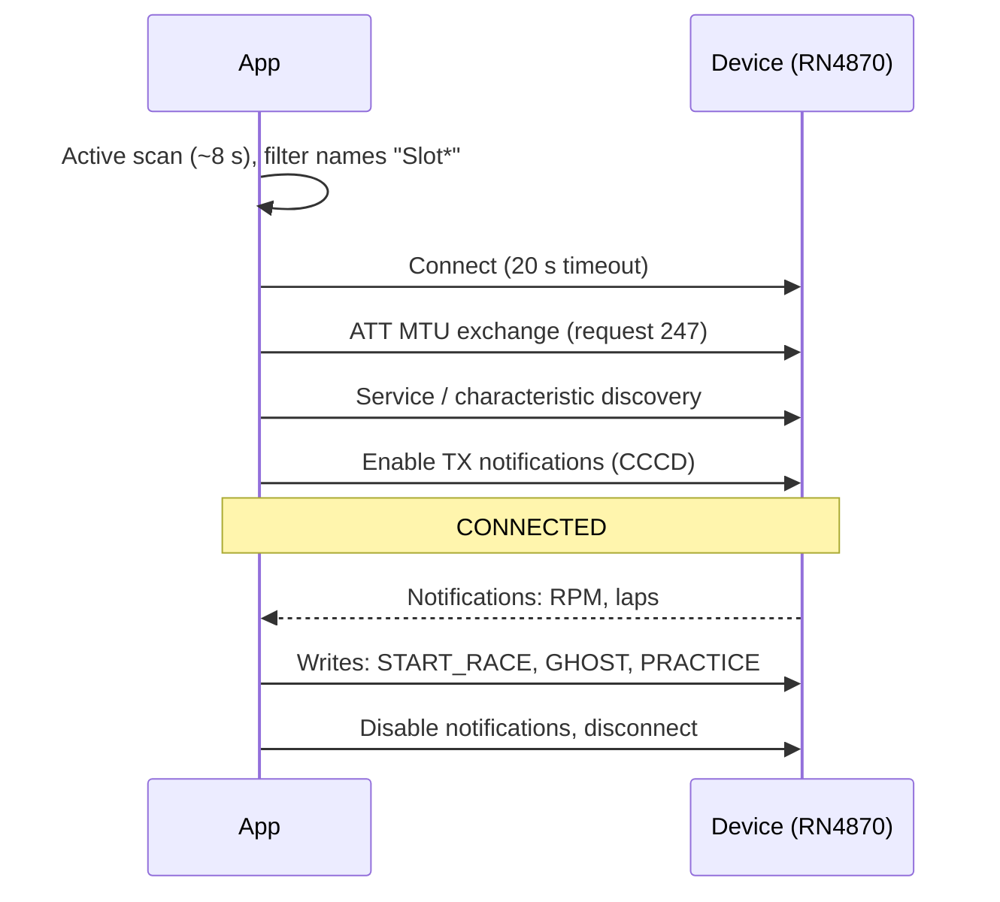
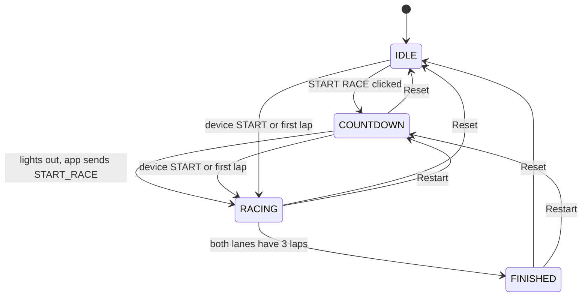

# Slot Car Duel — Bluetooth LE Protocol

**Protocol version:** 4.1 (app v4.1.0)

This document is the contract between the **Slot Car Duel PC application** (the *app*) and the **slot car timing hardware** (the *device*). It specifies everything firmware needs to interoperate with the app.

| Topic | Reference implementation |
|---|---|
| Message parsing and command bytes | [`src/slotcar/protocol.py`](src/slotcar/protocol.py) |
| BLE transport | [`src/slotcar/ble.py`](src/slotcar/ble.py) |
| Software device (firmware stand-in) | [`src/slotcar/simulator.py`](src/slotcar/simulator.py) |
| Conformance tests | [`tests/test_protocol.py`](tests/test_protocol.py) |

### At a glance

* The transport is a **Microchip RN4870** in *Transparent UART* mode over Bluetooth LE.
* All traffic is **plain ASCII text**, one message per line.
* The app sends 3 commands: **`START_RACE`**, **`GHOST:n`** and **`PRACTICE:n`**.
* The device sends **lap times** (`<C1,` / `<C2,`) and **RPM samples** (`<R1,` / `<R2,`). An optional CSV text format (`LAP`, `RPM`, `START`) is also accepted.
* **JSON is not supported.** JSON lines are ignored (see §11).

---

## 1. Protocol stack

```
┌──────────────────────────────────────────────────────────────┐
│ Messages      START_RACE · GHOST · PRACTICE · <Cn · <Rn · CSV │  §6–§7
├──────────────────────────────────────────────────────────────┤
│ Framing       ASCII lines, CR / LF terminated                 │  §5
├──────────────────────────────────────────────────────────────┤
│ Transport     RN4870 Transparent UART GATT service            │  §2
├──────────────────────────────────────────────────────────────┤
│ Link          Bluetooth Low Energy                            │  §3
└──────────────────────────────────────────────────────────────┘
```

The app is the **BLE central / GATT client**; the device is the **peripheral / GATT server**.

* Bytes the app writes to the RX characteristic come out of the RN4870's UART into the track micro-controller.
* Bytes the micro-controller writes into the RN4870's UART arrive at the app as notifications on the TX characteristic.

---

## 2. GATT profile

| Item | UUID | Direction | Required properties |
|---|---|---|---|
| Transparent UART service | `49535343-FE7D-4AE5-8FA9-9FAFD205E455` | — | primary service |
| TX characteristic | `49535343-1E4D-4BD9-BA61-23C647249616` | device → app | `notify` (or `indicate`) |
| RX characteristic | `49535343-8841-43F4-A8D4-ECBE34729BB3` | app → device | `write` and/or `write-without-response` |

**Fallback.** If the exact TX/RX UUIDs are missing or lack the required properties, the app takes the **first** characteristic *within the UART service* that has the needed property, and logs a warning. If the service itself is missing, the connection fails.

---

## 3. Discovery and connection



### 3.1 Device name: must start with `Slot`

The app's scan list shows only devices whose advertised name **begins with `Slot`**. The match ignores case and leading spaces; any text may follow.

| Advertised name | Shown? |
|---|---|
| `SlotCarMasters`, `Slot-Lane-01`, `SLOT`, `slot racer` | ✔ |
| `MySlotCar`, `Slo`, *(no name)* | ✘ |

* Set the name on the RN4870 with `SN,<name>`, e.g. `SN,SlotCarMasters`.
* The user can switch the filter off (**Slot\* devices only**) to see every named device. Don't rely on that.
* The first matching device is pre-selected.
* A device that also advertises the Transparent UART service UUID is marked with a **UART** badge. That's recommended but optional.

### 3.2 Connection steps

1. **Connect.** The timeout is 20 s, and the user may cancel while it's in progress.
2. **MTU.** The app requests an ATT MTU of **247** (244-byte payload) and logs the negotiated value. Any MTU works, because lines may span notifications (§5.2).
3. **Subscribe.** Notifications are enabled on TX. The app shows **CONNECTED**.
4. **Disconnect.** On user request or app close, the app disables notifications and disconnects.
5. **Link loss.** An unexpected drop is logged as `Bluetooth LE link lost`, and the app shows **OFFLINE**. There is **no automatic reconnect**.

---

## 4. Encoding

* **7-bit ASCII** only.
* Decimal numbers use `.` and have no thousands separator. Examples: `14.752`, `72`, `.5`.
* Bytes ≥ `0x80` are flagged in the diagnostics log. The line containing them will not parse and is ignored.

---

## 5. Framing

### 5.1 App → device

Each command is sent in **one GATT write**. The app first tries an acknowledged *Write Request*. If that fails, it retries once as a *Write Command* (write-without-response).

| Command | Terminator |
|---|---|
| `START_RACE` | **None.** Exactly 10 bytes, kept for compatibility with existing firmware. |
| `GHOST:n`, `PRACTICE:n` | `\r\n` (`0D 0A`) |

Firmware must treat `START_RACE` as complete when the 10th character arrives. It must not wait for a line terminator. A robust approach is to also accept it if it's followed by a terminator, or after a UART idle gap of more than 20 ms.

### 5.2 Device → app

The device sends a stream of ASCII lines. The app:

1. Appends each notification payload to a receive buffer. **Notification boundaries have no meaning**: a line may be split across notifications, and one notification may carry several lines.
2. Ends a line at **every** `\r` or `\n`.
3. Discards empty lines, which is how two-character terminators are absorbed.
4. Keeps at most the most recent 1024 buffered bytes if no terminator arrives (runaway protection).

All of these terminators are accepted: `\n\r` (the existing firmware), `\r\n`, `\n`, `\r`.
**New firmware should use `\r\n`** and keep each line under 64 bytes.

---

## 6. Commands — app → device

| Command | Bytes (hex) | Len | Sent when |
|---|---|---|---|
| `START_RACE` | `53 54 41 52 54 5F 52 41 43 45` | 10 | The start lights go out (§8). |
| `GHOST:5` + CRLF | `47 48 4F 53 54 3A 35 0D 0A` | 9 | **Ghost mode** is switched on. |
| `GHOST:0` + CRLF | `47 48 4F 53 54 3A 30 0D 0A` | 9 | **Ghost mode** is switched off. |
| `PRACTICE:45` + CRLF | `50 52 41 43 54 49 43 45 3A 34 35 0D 0A` | 13 | **Practice** is started. |
| `PRACTICE:0` + CRLF | `50 52 41 43 54 49 43 45 3A 30 0D 0A` | 12 | **Practice** is stopped. |

**`START_RACE`.** Arm the lap timers and start the race. The device should reset its per-lane lap counters. It may confirm by sending `START` (§7.2).

**`GHOST:<n>`: ghost run.** Any non-zero `n` starts the firmware's ghost run (`ghost.c`, `Ghost_Run`); the value itself is only tested for zero, and the app always sends `5` (`GHOST_ON_VALUE`).

* **Both cars are driven automatically.** The motor power ramps from 70 % up to a random target of 70–85 % in 2 % steps every 100 ms, back down to 70 %, then picks a new target.
* **RPM:** `<R1,…>` / `<R2,…>` lines are sent **only when a value changes**, starting with `<R1,70` `<R2,70`.
* **No lap times:** the lap sensors are disabled, so no `<Cn,` lines are sent.
* **Busy:** ghost mode is a blocking loop that **only listens for `GHOST:0`**. `START_RACE` and `PRACTICE:n` are not acted on until it ends.
* **`GHOST:0`** stops both motors and returns to idle, but **sends no final `<Rn,0`**. The app zeroes its gauges itself, and ignores RPM lines for 0.5 s so ones already in flight can't move the needles back up.

While ghost mode runs, the app shows **GHOST RUN** in the race bar and **GHOST CAR** on both lane cards.

**`PRACTICE:<n>`: practice session.** A non-zero `n` enables the motor drivers for manual driving; `0` disables them (`practice.c`). The app always sends `45` (`PRACTICE_ON_VALUE`). The current firmware sends **no RPM or lap lines** during practice. The track simulator does stream RPM in practice, as a preview.

**Ghost mode and Practice are separate from races.**

* When **START RACE** is clicked with either mode on, the app first sends `GHOST:0` and/or `PRACTICE:0` (this is required: the ghost loop would otherwise ignore `START_RACE`) and resets both buttons.
* While a race is counting down or running, the app refuses to switch the modes on, because the firmware's race loop (`Race_Run`) doesn't take commands until all laps are done.
* After the race (or a Reset), a single **Ghost mode** click sends `GHOST:5` again.

**When offline,** commands are **not queued**. The app shows a warning and logs `… not sent, no connection`, though the Ghost/Practice buttons still toggle on screen.

---

## 7. Messages — device → app

The app tries each line against **two** formats, in order:

1. **Native prefix format**: compact and recommended.
2. **CSV text format**: optional, for `printf`-style firmware.

Leading and trailing whitespace is ignored. A line matching neither format is **ignored** and logged as `Ignored unrecognised frame: '…'`. So is a line with an out-of-range value.

### 7.1 Native prefix format (recommended)

```
<{T}{D},{value}\r\n
```

| Field | Meaning |
|---|---|
| `<` | start marker |
| `T` | `C` = lap completed · `R` = RPM sample (case-insensitive) |
| `D` | lane: `1` or `2` |
| `,` | separator (spaces after it are allowed) |
| `value` | decimal number |

The app matches lines with `^<([CR])([12]),\s*([-+]?(?:\d+\.?\d*|\.\d+))\s*$`.

| Message | Value | Rules | Example | Bytes (hex) |
|---|---|---|---|---|
| `<C1,` / `<C2,` lap completed | lap time in **seconds** | must be > 0 | `<C1,14.752\n\r` | `3C 43 31 2C 31 34 2E 37 35 32 0A 0D` |
| `<R1,` / `<R2,` RPM sample | motor speed, **0–100 scale** | displayed clamped to 0–100 | `<R2,67\n\r` | `3C 52 32 2C 36 37 0A 0D` |

**Lap numbering is automatic.** The app counts laps per lane: the first `<C1,` is lane 1's lap 1, the next is lap 2, and so on. The firmware does not send a lap number.

### 7.2 CSV text format (optional)

Comma-separated, with case-insensitive keywords.

| Message | Syntax | Example | Bytes (hex) |
|---|---|---|---|
| Race started | `START` | `START\r\n` | `53 54 41 52 54 0D 0A` |
| Lap completed | `LAP,<lane>,<lap>,<time_ms>` | `LAP,1,2,14752\r\n` | `4C 41 50 2C 31 2C 32 2C 31 34 37 35 32 0D 0A` |
| RPM sample | `RPM,<lane>,<rpm>` | `RPM,2,67.5\r\n` | `52 50 4D 2C 32 2C 36 37 2E 35 0D 0A` |

* `<lap>` is an integer, `1`–`3`.
* `<time_ms>` is the lap time in integer **milliseconds**, > 0. Note: **milliseconds** here, but seconds in the native format.
* `<rpm>` is a number on the 0–100 scale.
* `LAP` carries an **explicit** lap number. Sending the same lap number again **overwrites** that lap's time.

**Lane identifiers** accepted in CSV `<lane>` (case-insensitive):

| Lane 1 | Lane 2 |
|---|---|
| `1`, `left`, `lane1`, `car1` | `2`, `right`, `lane2`, `car2` |

---

## 8. Race semantics



* **Start sequence.** Clicking **START RACE** switches off Ghost mode / Practice if active (§6) and clears all times. Five red lights then come on at 0.8 s intervals, hold for a randomised 1.2–2.2 s, and go out. **`START_RACE` is sent at lights-out**, about 5.2–6.2 s after the click.
* **Race length.** 3 laps per lane. An extra auto-numbered lap is rejected and logged.
* **Winner.** The lane with the **lowest total of its 3 lap times**; on an exact tie, lane 1 wins. The winner is decided once, as soon as both lanes have 3 laps.
* **Laps before the start.** Recorded anyway with a warning, and the race moves to RACING.
* **Device `START`.** Moves IDLE or COUNTDOWN to RACING, shows green lights and zeroes the gauges. Existing lap times are kept.
* **Shown by the app, not sent by the device:** each lane's personal best (green), the overall fastest lap (purple), and the gap between lanes after the same number of laps.

---

## 9. Firmware timing guidance

| Stream | Rate | Notes |
|---|---|---|
| RPM `<Rn,` | 5–10 Hz per lane | The UI animates at about 30 fps with easing, so 10 Hz is smooth. Send a final `0` when the car stops. |
| Lap `<Cn,` | on event | Send immediately when the car crosses the line, with ≥ 1 ms resolution. |
| Total | ≤ 50 lines/s | Several lines may share one notification. |

---

## 10. Example session

```
App → Dev   START_RACE                    lights out
Dev → App   <R1,12\n\r                    RPM streaming begins (~10 Hz per lane)
Dev → App   <R2,9\n\r
            …
Dev → App   <C2,5.671\n\r                 lane 2 · lap 1
Dev → App   <C1,6.217\n\r                 lane 1 · lap 1
Dev → App   <C2,5.239\n\r                 lane 2 · lap 2   personal best
Dev → App   <C1,6.621\n\r                 lane 1 · lap 2
Dev → App   <C2,5.009\n\r                 lane 2 · lap 3   lane 2 finished
Dev → App   <C1,4.820\n\r                 lane 1 · lap 3   fastest lap · race finished
                                          winner: lane 2  (15.919 s vs 17.658 s)
Dev → App   <R1,0\n\r  <R2,0\n\r          cars stopped
```

---

## 11. Unsupported input

These are **ignored** (logged, never acted on):

| Input | Example | Notes |
|---|---|---|
| JSON | `{"type":"lap","driver":1,"lap":2,"time_ms":14752}` | Support was removed in v4.1. Use the native or CSV format. |
| Lane other than 1 or 2 | `<C3,5.0`, `LAP,9,1,100` | |
| Lap number outside 1–3 | `LAP,1,4,100` | |
| Zero or negative lap time | `<C1,0`, `LAP,1,1,0` | |
| Malformed number or field count | `<C1,abc`, `LAP,1,2` | |
| Non-ASCII bytes | | |

---

## 12. Diagnostics

The **Pit Wall** window (sidebar, or `Ctrl+B`) has a timestamped log. Turn on **Raw RX/TX** to see every payload as text and hex:

```
08:49:18.871  TX 'START_RACE'  [53 54 41 52 54 5f 52 41 43 45]
08:49:18.993  RX '<R1,72\n\r'  [3c 52 31 2c 37 32 0a 0d]
08:49:19.012  Ignored unrecognised frame: '<C3,1.0'
```

* `RX` lines are notification payloads **before** framing, which helps when debugging terminators and chunking.
* The log keeps the last 1,500 entries.

**Simulator.** *Pit Wall → Simulator* (or `run.ps1 -Simulate`) replaces the BLE link with a software device that implements this protocol from the firmware side:

* It reacts to `START_RACE`, `PRACTICE:n` and `GHOST:n`.
* It streams `\n\r`-terminated `<Rn,` and `<Cn,` lines through the app's real framing and parsing code.

That makes it a working reference for firmware developers.

---

## 13. Firmware checklist

- [ ] Advertised name starts with **`Slot`** (`SN,SlotCarMasters`). Advertising the UART service UUID is recommended.
- [ ] Accept `START_RACE` with **no terminator**. Accept `GHOST:n` and `PRACTICE:n` terminated by `\r\n`.
- [ ] On `START_RACE`, reset the per-lane lap counters and leave ghost/practice mode.
- [ ] Send laps as `<Cn,<seconds>`: at most 3 per lane per race, each time > 0.
- [ ] Send RPM as `<Rn,<0-100>` at 5–10 Hz, ending with `0`.
- [ ] Terminate every line with `\r\n` (or the legacy `\n\r`), and keep lines under 64 bytes.
- [ ] Send **no JSON**.
- [ ] Don't rely on notification boundaries.

---

## Change history

| Version | Changes |
|---|---|
| 4.1 | **JSON message format removed.** Ghost mode documented from the firmware (`ghost.c`); the simulator now reproduces it, and the app zeroes its gauges on `GHOST:0`. Starting a race now sends `GHOST:0` / `PRACTICE:0` if those modes are on, so app and device agree. Before this, the first Ghost click after a race turned ghost mode *off*. |
| 4.0 | Scan filter for `Slot*` names. `START_RACE` sent at lights-out instead of on click. Single `\r` or `\n` terminators accepted. |
| 3.x | Original ATE Slot Car Duel protocol: native, JSON and CSV formats. |
